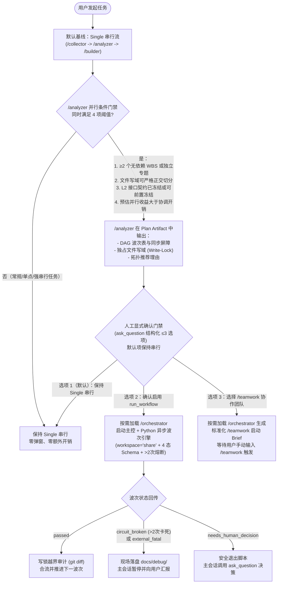

在前期完成全局技能资产收敛与原生指令融合后，由 `collector`、`researcher`、`analyzer`、`builder`、`verifier`、`reviewer` 构成的六角研发中枢（Hexagon Pipeline）已经在单会话串行闭环上运转成熟。但当任务规模扩展至多模块 WBS 波次研发、大范围跨目录审计或多路并行调研时，这套单线程体系暴露出明显的吞吐瓶颈。

然而，引入多 Agent 并行并非“把所有任务都拆成多线程”那样简单。无节制的并行会带来三类高昂成本：日常单点修改被迫加载冗长的编排指令导致 Token 预算持续膨胀、多 Worker 并发写文件引发不可控的合并冲突、以及子 Agent 局部报错后无人兜底导致的无限空转。

因此，本次针对个人全局 SKILL 体系的并行编排改造，首先确立了一条克制的架构底线：**默认关闭、零日常开销、人工显式确认后按需启动（Default-Off & Human-Confirmed Opt-In）**。本文记录这一架构改造的问题诊断、选型权衡、核心契约与验收门禁。

---

## 1. 规划与执行的断层：现状盘点与原生原语边界

实地核查 `~/.gemini/config/skills/` 下的 6 个核心技能文件，可以发现体系内部存在一处典型的“规划提了一嘴并行、执行全靠单线程硬扛”的架构断层：

- **上游规划缺少可落地的拓扑契约**：`analyzer/SKILL.md` 中虽然留有 5 行 `Execution Topology Recommendation` 占位说明，但既未定义默认关闭与人工确认门禁，也未区分不同并行原语的适用条件，更未要求输出 DAG 波次表、同步屏障与独占文件写域（Write-Lock）。
- **下游执行与验收停留在纯串行假设**：`builder/SKILL.md` 仅面向单会话 `/goal` 串行闭环（重试预算 ≤ 3 轮），缺少 Worker 态的写锁遵守契约与结构化状态返回规范；`verifier` 虽具备 `2-Fail` 熔断哲学，却缺少批量验真的统一裁决 Schema；`reviewer` 缺少多工作区合流前的写锁越界审计；`collector` 与 `researcher` 也缺少在 Wave 0 并发事实锚定时的结构化合流契约。

要填补这一断层，先要看清底层平台原生提供的四类执行原语及其物理边界，避免把工具用在错配的场景中：

| 维度 | `Single`（默认基线） | `invoke_subagent`（轻量并发） | `run_workflow`（确定性波次引擎） | `/teamwork`（`/swarm` 协作团队） |
| :--- | :--- | :--- | :--- | :--- |
| **默认状态** | **默认开启** | 默认关闭（仅独立只读/双路短任务按需） | **默认关闭（须人工确认）** | **默认关闭（严禁自动触发，仅限用户手动输入）** |
| **控制拓扑** | 主会话单线程串行 | 主会话同回合拉起多个独立子 Agent，事件驱动唤醒 | Python 异步脚本充当确定性状态机（`parallel`/`pipeline`/`phase`） | 共享公开消息板（`@mention`）+ 角色自由协商 |
| **隔离能力** | 共享当前工作区 | 支持 `share` / `branch` / `inherit` | 支持 `share` / `branch` / `inherit` | 支持 `share` / `branch` / `inherit` |
| **子 Agent 通信** | N/A | 仅与主会话单向/双向通信 | **彼此不可见**；由编排脚本跨轮纠偏并校验 JSON `schema` | **共享公开消息板**，适合跨模块开放式讨论与互相评审 |
| **熔断与 HITL** | 依赖 `/goal`（≤ 3 轮）或 `/verifier`（2-Fail） | 主会话可直接弹窗暂停，但重试计数依赖会话上下文记忆 | **代码级硬熔断**（精确 `max_stalls = 2` + 错误指纹去重）；脚本内不可直接问用户，需退回主会话调用 `ask_question` | 依赖监控角色检测全员停滞，缺少代码级精确失败计数与强制 Schema |
| **关键工程陷阱** | 长任务串行耗时高 | 并发 ≥ 3 或多波次时主会话易上下文膨胀 | `parallel()` 内任一未捕获异常会取消同组所有协程，**需在协程内做 `try/except` 隔离** | 协调成本高，用于确定性 WBS 流水线反而更慢且易漂移 |

---

## 2. 架构选型：为什么是“薄钩子 + 按需第 7 中枢”

如何在不污染日常单线程体验的前提下，把上述并行原语安全接入全局技能体系？对比三种异构方案的利弊后，架构选择非常清晰：

- **方案 A（全量内嵌）**：将 `run_workflow` 状态机模板、写锁审计和 `/teamwork` Brief 规范全部塞进 `analyzer` 和 `builder`。代价是两个高频技能体积直接膨胀至 180 行以上，每一次普通的单文件修改都要为用不上的并行规则支付上下文成本，直接违背“零日常开销”边界。
- **方案 B（完全独立第 7 技能）**：新增 `/orchestrator` 而现有 6 个技能一字不改。代价是上下游完全脱节——`analyzer` 不会在规划期产出 DAG 波次与写锁表，也不会在满足阈值时发起人工确认；`builder` 被拉起为 Worker 时也没有写锁与状态返回约束。
- **方案 C（薄钩子 + 按需中枢，最终选定）**：
  1. **薄钩子层**：对现有 6 个核心技能仅做 **≤ 15 行**的轻量增量编辑，注入默认关闭声明、触发阈值、Worker 态契约与合流审计条款。
  2. **按需中枢层**：新增第 7 个按需加载的全局技能 `~/.gemini/config/skills/orchestrator/SKILL.md`。平时完全不进入上下文，仅在用户显式确认启用并行后按需加载，集中承载 `run_workflow` 安全并发模板与 `/teamwork` 协作启动协议。

在这一架构下，并行编排的唯一合法入口被严格锁定为**“条件触发评估 → 人工显式确认 → 路由至对应引擎”**的三段式状态机：

这一流程同时划定了 `run_workflow`、`/teamwork` 与 `invoke_subagent` 的正交分工：

- **选用 `run_workflow`**：适用于结构化 WBS 流水线、批量文件审计、Wave-0 多路调研（`collector` ∥ `researcher`）以及按冻结接口合约编码的多模块任务。成立条件是 L2 契约清晰、子 Agent 无需互相聊天、且要求代码级精确熔断；若接口频繁变动或需要角色间开放辩论，该模式会因反复退回主会话而失效。
- **选用 `/teamwork`（`/swarm`）**：适用于开放式架构探索、跨模块强耦合联调、需要多角色在公开消息板上辩论对齐的大型课题。严守平台红线——Agent 永不自动调用 `swarm`，由 `/orchestrator` 输出标准化启动 Brief，交由用户手动输入 `/teamwork` 触发。
- **选用 `invoke_subagent`**：仅适用于并发度 = 2 且无需多波次状态机的短任务（如双路独立单测或双专题快速调研），由主会话同回合并发拉起并在 2 次重试上限内收口。

---

## 3. 跨项目复用的四项确定性契约

从前期多模块工程实践的 WBS 并行编排蓝本中，本次改造提炼出 4 项跨项目复用的硬契约，固化进 `/orchestrator` 与各技能薄钩子中：

### 3.1 契约前置屏障（Contract-First Barrier）

凡涉及多 Agent 并行写代码的波次，前序节点均设立强制同步屏障：先在 `docs/feats/` 冻结跨模块接口与数据结构契约（L2），再在 `docs/steps/` 维护当前波次的轻量实施单，明确记录波次划分、独占文件写域、确定性验收命令以及任务状态与失败计数。契约未冻结前，严禁启动并行编码波次。

### 3.2 独占文件写域与合流越界审计（Disjoint Write-Lock Scope）

同波次并发写代码的 Worker，分配两两互不相交的目录或文件写域，并统一采用 `workspace="share"`（共享底层仓库目录但工作区隔离；纯只读调研则保持 `inherit`）。在任何分支合流前，由主控或 `/reviewer` 执行 `git diff --name-only` 校验：一旦检测到超出声明写域的修改，直接阻断合流并打回处理，从物理层面消除“两个 Agent 偷偷改了同一个公共文件”的静默覆盖风险。

### 3.3 Worker 四态 JSON Schema 与协程异常隔离

所有由 `run_workflow` 调度的 Worker，完成任务时统一按四态 JSON Schema 通过 `finish` 返回结构化结果：

- `task_id`：任务或 WBS 编号；
- `status`：严格收敛为四个枚举值——`passed`、`retryable_failed`、`needs_human_decision`、`external_fatal`；
- `error_signature`：归一化后的错误指纹，用于识别“换汤不换药”的原地打转；
- `changed_files`：实际修改的相对路径数组；
- `verification_evidence`：验收命令与退出码摘要；
- `decision_request`：仅在 `needs_human_decision` 时填充，提供 ≤ 3 个带推荐项的结构化决策选项。

在 Python 编排脚本侧，每个 `parallel()` 协程内部均包裹 `try/except`，将运行时异常捕获并转化为结构化失败状态返回，防止单个 Worker 崩溃触发异常传播、误杀同波次其他正在健康推进的协程。

### 3.4 统一熔断与 HITL 升级协议（Circuit Breaker）

编排脚本将失败处理严格划分为四档，彻底区分“可静默自愈”与“需人工介入”：

1. **静默自愈**：返回 `retryable_failed` 且当前卡死计数 `stall_count < 2` 时，向同一保留上下文的 `worker = agent(...)` 注入报错日志自动纠偏，不打断用户。
2. **卡死熔断（退出上报）**：连续失败达到 3 次（即重试卡死 > 2 次），或连续 2 轮产出相同 `error_signature`（原地打转），立即触发代码级熔断，并将完整错误上下文落盘至 `docs/debug/breaker-<task_id>.md`。
3. **外生硬故障穿透**：返回 `external_fatal`（如权限不足、网络阻断、缺失宿主依赖、沙盒拦截）时，第 1 次即直接穿透上报，禁止无效空转。
4. **人工必要决策暂停**：返回 `needs_human_decision` 时，安全退出编排脚本，由主会话接管并调用 `ask_question` 交由用户拍板。

---

## 4. 增量改造清单与五项验收门禁

整套改造拆解为 6 个精准的 WBS 单元，由 `/builder` 串行落地。值得注意的是，本次改造任务自身并不满足并行阈值——它涉及 7 个小型 Markdown 技能文件且存在跨技能术语强一致性约束，因此按规则采用默认 `Single` 串行模式编辑并一次性交叉核对，效率最高且零冲突。

| WBS | 目标文件 | 改造类型 | 精准增量改动摘要 |
| :--- | :--- | :--- | :--- |
| **WBS-1** | `config/skills/orchestrator/SKILL.md` | **新增**（按需加载） | 建立第 7 中枢技能：Default-Off 守门规则、4 类拓扑决策矩阵、`run_workflow` 安全并发 Python 模板、`workspace="share"` 写锁合流步骤、`/teamwork` 标准化启动 Brief 模板 |
| **WBS-2** | `config/skills/analyzer/SKILL.md` | 增量编辑（约 +15 行） | 升级 `Execution Topology Recommendation`：明确 Default-Off、加入 4 项并行触发条件、输出 DAG 波次与写锁表、挂载 `ask_question` 人工确认门禁及 `/teamwork` 严禁自动触发红线 |
| **WBS-3** | `config/skills/builder/SKILL.md` | 增量编辑（约 +12 行） | 新增 `Parallel Execution & Worker Contract (Default-Off)`：声明默认单会话串行；作为 Worker 运行时强制遵守写锁域、4 态 JSON 返回与 > 2 次熔断标准 |
| **WBS-4** | `config/skills/verifier/SKILL.md` | 增量编辑（约 +6 行） | 补充批量验真兼容条款，支持按统一 JSON Schema 输出裁决与 `error_signature`，与现有 `2-Fail` 熔断器对齐 |
| **WBS-5** | `config/skills/reviewer/SKILL.md` | 增量编辑（约 +6 行） | 在 `Scope Compliance` 下新增多工作区合流前的 `git diff --name-only` 写锁越界审计 |
| **WBS-6** | `config/skills/collector/SKILL.md` & `researcher/SKILL.md` | 增量编辑（各约 +4 行） | 补充 Wave-0 并发事实锚定时的结构化分节/JSON 输出兼容说明，日常独立调用零变化 |

改造完成后，需逐项通过 5 道确定性验收门禁，缺一不可：

1. **默认静默验证（Default-Off Gate）**：发起常规单文件或线性重构任务，验证 `/analyzer` 与 `/builder` 严格保持 `Single` 串行流，不弹窗询问并行、不加载 `/orchestrator`、不调用 `run_workflow` 或 `swarm`。
2. **条件触发与人工确认验证（Opt-In Gate）**：发起包含 ≥ 2 个独立模块的多 WBS 任务，验证 `/analyzer` 能准确输出 DAG 波次与写锁表，并通过 `ask_question` 提供“默认串行 / `run_workflow` / `/teamwork`”选项；若用户选择默认串行，系统严格退回串行流。
3. **平台红线验证（`/teamwork` Non-Auto-Invoke）**：核查所有全局技能文本，确保在未由用户显式输入 `/teamwork` 或 `/swarm` 时，无任何诱导 Agent 擅自调用 `swarm` 工具的表述；用户选择 `/teamwork` 时仅输出标准化 Brief 并提示手动触发。
4. **契约一致性验证（Cross-Skill Consistency）**：由 `/verifier` 交叉核对 `analyzer`、`builder`、`verifier`、`reviewer`、`orchestrator` 五者之间的 4 态枚举名、熔断阈值（> 2 次 / 同错 × 2）与写锁审计口径，确保零术语漂移。
5. **Token 体量门禁（Anti-Bloat Check）**：核验原有 6 个核心 `SKILL.md` 的单文件增量均严格控制在 ≤ 20 行以内，守住高频基础技能的轻量底线。

---

## 下一步行动

这套架构方案落盘后，接下来的推进路径清晰且克制：

1. **串行落地 WBS-1 至 WBS-6**：以单会话模式完成第 7 中枢 `/orchestrator` 创建及 6 个核心技能的薄钩子注入，并立即执行上述 5 项确定性验收门禁。
2. **真实多模块场景灰度校准**：选取一个具备明确 L2 接口契约的多模块仓库，实测 Wave-0 并发调研与 WBS 并行编码的端到端耗时、Token 消耗及写锁合流拦截率，用真实数据校准“并行收益大于协调开销”的触发阈值。
3. **跨环境边界适配**：针对本地全局配置目录存在系统保护边界的场景，固化“方案与补丁输出至 Artifact → 外部终端一键同步”的标准落地流程，避免因平台写入权限限制打断配置演进。
